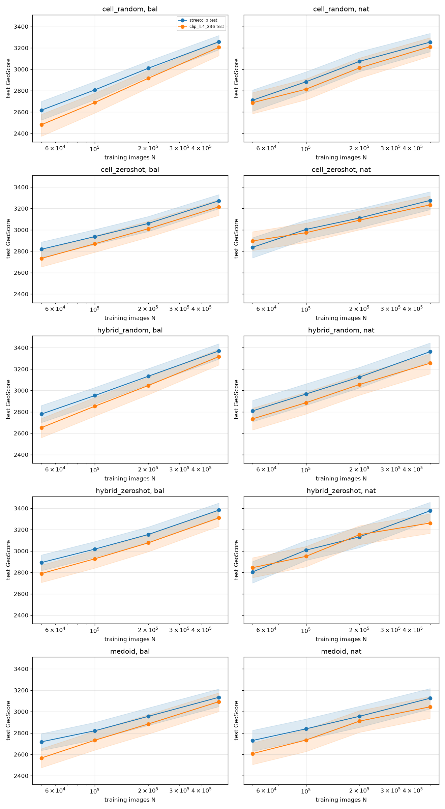
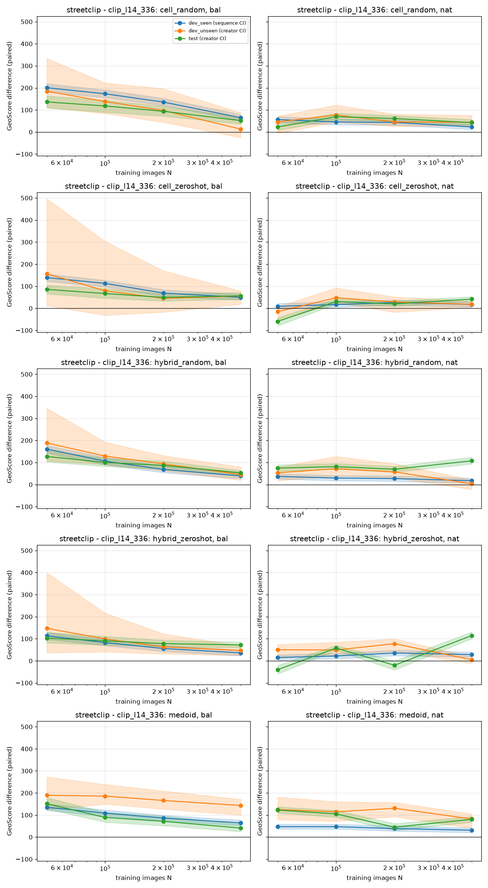
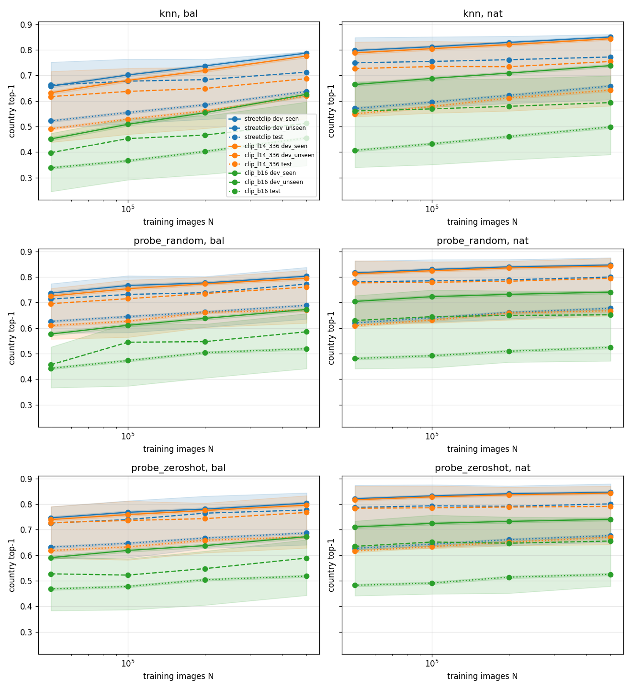
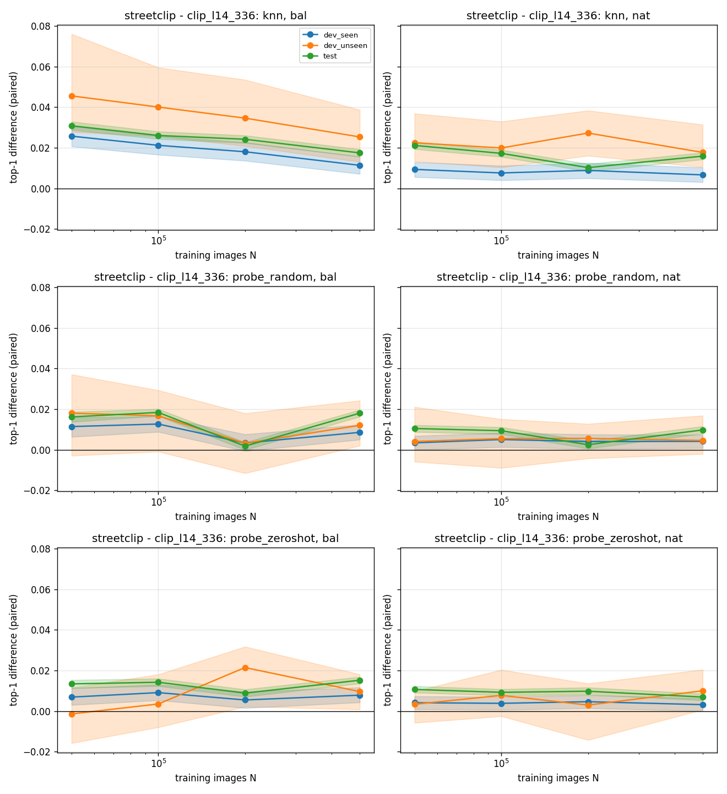
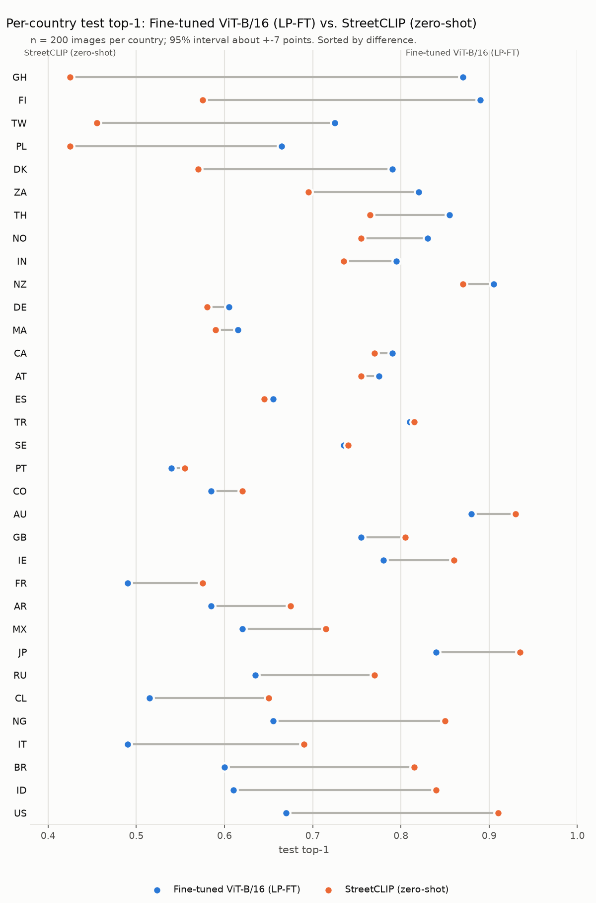
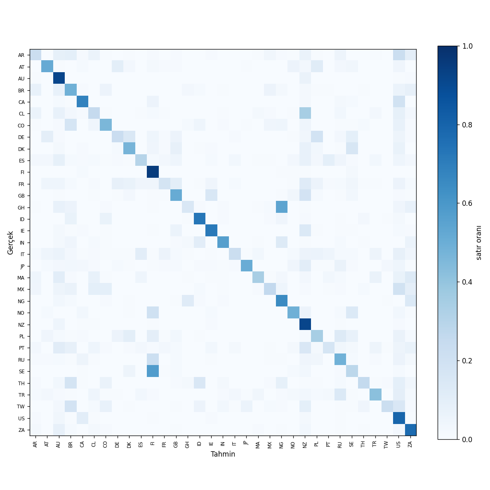
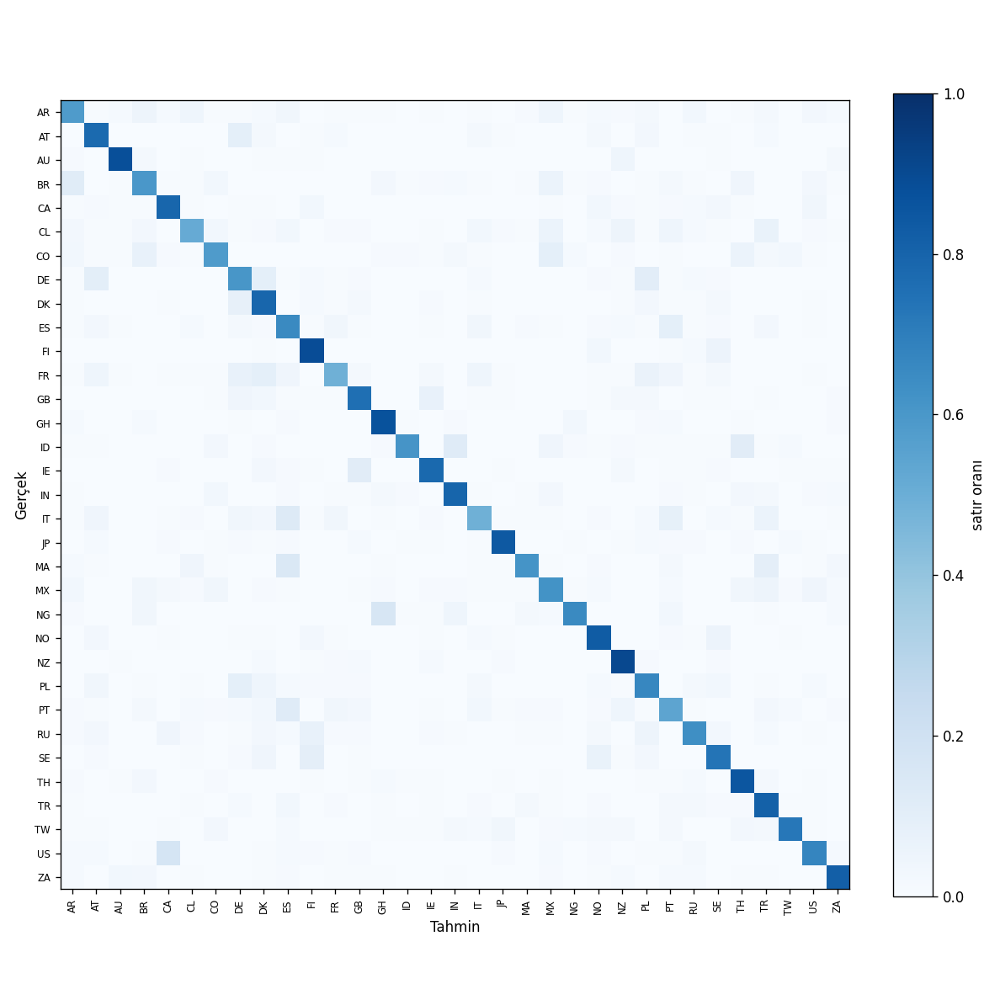
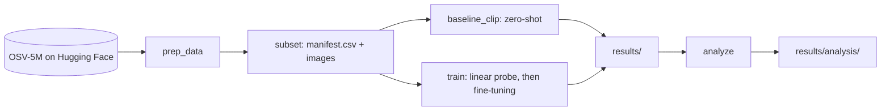

# geoguessr-ai


Where was a street photo taken? Three versions on [OpenStreetView-5M](https://huggingface.co/datasets/osv5m/osv5m), newest first.
Each one reads its test split once, at the end.

- **V3: coordinates.** Pre-registered. Frozen StreetCLIP vs CLIP L/14-336 backbones, scored in
  GeoScore (km) on the official test set.
- **V2: StreetCLIP vs its CLIP L/14-336 base, 216 countries.** Pre-registered. Country top-1 with
  frozen backbones, 50K–500K training images.
- **V1: 33-country classification.** Zero-shot CLIP, linear probe and fine-tuning (LP-FT), with a
  browser demo.

- **Live demo (runs in your browser):** https://huggingface.co/spaces/Daggerabuse/geoguessr-ai
  (countries, V1) and [coords.html](https://daggerabuse-geoguessr-ai.static.hf.space/coords.html) (coordinates, V3)
- **Model:** https://huggingface.co/Daggerabuse/geoguessr-clip-vitb16

## V3 (Phase 3): StreetCLIP vs CLIP L/14-336 in kilometres (OSV-5M test, pre-registered)

**Question.** V2 compared the two backbones on country labels. V3 asks the same question for
coordinates. The metric is GeoScore, 5000 · exp(−km / 1492.7) per image, averaged (0–5000). Both
backbones are frozen. Training subsets are 50K–500K images, in natural (`nat`) or
country-balanced (`bal`) order. There are five predictors:
- a kNN geographic medoid;
- a 5000-geocell probe, with random or zero-shot text init;
- a hybrid of the two: kNN restricted to the probe's top cells.

**Answer: 4 of 5 pre-registered hypotheses supported.** The test is one-sided, uses a paired
creator-cluster bootstrap (10,000 resamples) and is Holm-corrected over the 5 hypotheses. It
covers 210,122 test images from 5,323 creators. "Gap" means StreetCLIP minus L/14-336 GeoScore on
the same images, with the zero-shot hybrid unless the row says otherwise.

| | Hypothesis (> 0) | Estimate [95% CI] | Holm p | Verdict |
|---|---|---|---|---|
| H1 | gap at bal 50K | **+102.9** [79.7, 129.6] | 0.0005 | ✅ supported |
| H2 | gap at nat 50K | **−39.8** [−60.4, −20.2] | 1.0 | ❌ not supported |
| H3 | gap shrinks bal 50K → 500K | **+30.7** [9.2, 54.7] | 0.0048 | ✅ supported |
| H4 | zero-shot init narrows the cell-probe gap, nat 50K | **+82.4** [61.2, 104.9] | 0.0005 | ✅ supported |
| H5 | the same at bal 50K | **+50.8** [30.3, 72.0] | 0.0005 | ✅ supported |

**H2 is not supported; the estimate is in the opposite direction (the CI excludes 0).** On dev it
was positive: +14.9 on dev_seen, +50.3 on dev_unseen. This is an unpredicted observation in one
cell, not a confirmed reverse effect, and we have no explanation for it.

**Numbers.** Test GeoScore of the zero-shot hybrid (exploratory, as are all numbers in this
paragraph):

| | nat 50K | bal 50K | nat 500K | bal 500K |
|---|---|---|---|---|
| StreetCLIP | 2804 | 2892 | 3376 | 3383 |
| L/14-336 | 2844 | 2789 | 3262 | 3310 |

- At 500K the median error is 316–376 km.
- Test is far harder than dev: on average 989 GeoScore below dev_seen across the 80 cells.
- The hybrid beats the kNN medoid by +234 [206, 263] at nat 500K (E1). This comparison is not
  like for like: the kNN parts are masked within 1 km, the probe is not.

**Checks.**
- Every probe was retrained before test was read. 32/32 matched the dev GeoScore exactly on GPU,
  and 80/80 cells were inside the pre-registered tolerance on CPU in both test sessions.
- All 80 scored cells carry one run identity (pre-registration sha `6aef5a15…`, commit `86d9f8b`).
- A local re-run of the analysis reproduces `primary.csv`.




**Limitations (main ones; all are in the results doc).**
- Every choice was made on dev_seen, which shares creators with train. Several choices sit at a
  grid edge: 13/32 probes at the lowest lr, 23/32 hybrids at m = 5.
- Each backbone has its own k, m, lr and epoch, so a gap includes how well the grids suit each
  backbone.
- There is one training-subset draw and one seed.
- H1/H2 were not blind to V2's country results on the same test images.
- Nothing here is about fine-tuned models or causes.

- Pre-registration: commit [`86d9f8b`](https://github.com/Daggerabuse/geoguessr-ai/commit/86d9f8b328b0bf93f626d0dea0b17bb04c46f540),
  [docs/V2_PIPELINE.md](docs/V2_PIPELINE.md#phase-3-pre-registration-coordinates-on-the-official-test-split)
- Results, all tables, reproduction check, dev vs test: [results/v3/PHASE3_TEST_RESULTS.md](results/v3/PHASE3_TEST_RESULTS.md)
- Dev evidence: [results/v3/PHASE3_DEV_SUMMARY.md](results/v3/PHASE3_DEV_SUMMARY.md)

### V3 demo

`web/coords.html` (same Space as the country demo) runs one V3 predictor in the browser: StreetCLIP
→ the cell probe (zero-shot init, `nat`, N = 500K; the head of the test run, sha `2454e620…`) → softmax
over the 5000 cells of the pre-registered partition → the top-5 cell centroids on an OpenStreetMap map.
It is not the best V3 predictor: the hybrids also search the 500K training embeddings, which do not fit
in a browser. Preprocessing is the one the embeddings were made with (one center crop, long side
truncated), and a test checks that the JS gives the same pixels as `embed.clip_center_crop`.

Files: [Daggerabuse/geoguessr-streetclip-geocells](https://huggingface.co/Daggerabuse/geoguessr-streetclip-geocells),
written by `export_geo_demo`. The encoder (CC BY-NC 4.0) and the head/centroids (from OSV-5M,
CC BY-SA 4.0) are separate files, because the two licences cannot be combined into one; the demo is
non-commercial. Agreement with PyTorch on 500 photos from `data/sample` (`results/onnx_parity/v3_geocells.json`)
and in headless Edge (`scripts/v3_web_check.py`; 8-bit: `results/onnx_parity/v3_web_int8.json`; the fp32
browser row is from a first run whose report was not saved):

| | fp32 ONNX | 8-bit ONNX |
|---|---|---|
| Size | 1219 MB | 351 MB |
| Top-1 cell = PyTorch (500 photos) | 1.000 | 0.982 |
| Top-5 set = PyTorch (500 photos) | 1.000 | 0.922 |
| Top-1 centroid distance to PyTorch's, mean / max | 0 km | 94 km / 15,351 km |
| GeoScore vs true coordinates, mean [95% CI] (PyTorch: 3366 [3203, 3516]) | 3366 [3203, 3516] | 3366 [3203, 3517] |
| Median km to the true location (PyTorch: 301 km) | 301 km | 301 km |
| Paired GeoScore difference vs fp32 [95% CI] | | +0.1 [−22.8, +21.1] (9 photos change cell) |
| Browser = onnxruntime (Edge, same variant) | 5/5 photos | 20/20 photos |
| Model time per photo, Edge, one WASM thread (this PC) | about 15 s | 17–21 s (two runs) |

GeoScore is that of the top-1 cell's centroid (5000 · exp(−km / 1492.7)). The intervals resample creators
(321 of them, 10,000 resamples, seed 42; `results/onnx_parity/v3_geocells.json`, per-image cells in
`v3_geocells_per_image.csv`). **The 500 photos are from the OSV-5M test split.** They were used only to choose
the demo's default precision (8-bit), after the pre-registered analysis was final; nothing in the V3 results
depends on them. With 500 photos the interval of the paired difference is about ±22 GeoScore, so a small loss
from 8-bit cannot be excluded; the point estimate shows none.

The 8-bit model changes the top-1 cell for about 2% of photos. When it does, it picks another cell the
model scored almost as high, and that cell can be on another continent. The page is single-threaded
(the Space is not cross-origin isolated), so a photo takes tens of seconds. These are agreement
numbers, not accuracy.

## V2: StreetCLIP vs its CLIP L/14-336 base — how much is the head start worth? (OSV-5M, 216 countries)

**Question.** StreetCLIP is CLIP ViT-L/14-336 further trained on street-level images with country/region/city captions. With the same architecture and resolution, is it a better frozen backbone for country classification at small training sizes, and does the gap close as labelled data grows? This compares one model pair; StreetCLIP adds both in-domain images and caption supervision close to this task, so it is not a test of "geographic pretraining" in general.

**Answer (pre-registered test, Holm-corrected).** **H1, 6/6:** at 50K training images StreetCLIP beats CLIP L/14-336 on the official OSV-5M test set for every classifier and sampling scheme, by **+1.0 to +3.1 top-1 points**. **H2 (the gap shrinks 50K → 500K), 3/6:** supported for kNN/bal, kNN/nat and zero-shot-probe/nat, but only **kNN/bal** shrinks monotonically across N and survives the post-hoc checks below; the other two are within hyperparameter and clustering noise.

### Setup
- **Data:** OSV-5M (4.89M train / 210K test street-view images), 216 countries present in both splits. Creator-disjoint `dev_unseen` (20K) and a `dev_seen` split (19.9K, one image per sequence) for model selection; the official test set was only read once, at the end.
- **Backbones:** CLIP ViT-B/16, CLIP ViT-L/14-336, StreetCLIP (frozen).
- **Training subsets:** nested 50K / 100K / 200K / 500K, in two orderings — `nat` (natural country distribution) and `bal` (country-balanced).
- **Classifiers:** kNN, and a linear probe initialised either randomly or from the zero-shot text head. Hyperparameters (k, learning rate, epoch) selected on `dev_seen` only.
- **Scale:** 803,889 train/dev images × 3 backbones embedded in a single ~6.6 h session on 2× T4 (free Kaggle), streaming 246 GB of ZIPs with ≤13 GB disk; 210,122 test images × 3 backbones in 1.7 h.

### Evaluation protocol
- **Pre-registration:** frozen hyperparameters and 12 primary hypotheses (H1: gap > 0 at 50K; H2: gap(50K) − gap(500K) > 0, for each classifier × ordering) were committed *before* any test image was embedded (`configs/phase1_final.json`).
- **Statistics:** paired cluster bootstrap over sequences (10,000 resamples), one-sided p-values, Holm–Bonferroni across all 12 (family-wise α = 0.05). Everything else is labelled exploratory.
- **Honesty note:** the pre-registration is a self-discipline mechanism based on git timestamps, not cryptographic proof.

### Results (test set, StreetCLIP − L/14-336, top-1 points)

| | kNN bal | kNN nat | probe (random) bal | probe (random) nat | probe (zero-shot) bal | probe (zero-shot) nat |
|---|---|---|---|---|---|---|
| **H1:** gap at 50K | **+3.08** ✅ | **+2.12** ✅ | **+1.62** ✅ | **+1.04** ✅ | **+1.34** ✅ | **+1.07** ✅ |
| **H2:** gap shrinks 50K→500K | **+1.33** ✅ | **+0.53** ✅ | −0.18 ❌ | +0.07 ❌ | −0.18 ❌ | +0.37 ✅ |

All supported hypotheses have Holm-adjusted p = 0.0012 (the floor for 10,000 resamples × 12 tests).

**All four N (descriptive, test top-1 gap in points).** H2 uses only the endpoints; between them the gap is not monotone except for kNN/bal:

| | 50K | 100K | 200K | 500K |
|---|---|---|---|---|
| kNN bal | 3.08 | 2.61 | 2.42 | 1.75 |
| kNN nat | 2.12 | 1.72 | 1.02 | 1.59 |
| probe (random) bal | 1.62 | 1.84 | 0.18 | 1.80 |
| probe (random) nat | 1.04 | 0.94 | 0.25 | 0.98 |
| probe (zero-shot) bal | 1.34 | 1.42 | 0.88 | 1.52 |
| probe (zero-shot) nat | 1.07 | 0.92 | 0.98 | 0.69 |

Neighbouring N differ by up to 1.6 pt, several times the bootstrap CI half-width (~0.2 pt). **The bootstrap CIs cover test sampling only**, not hyperparameter selection, the single probe run or the single training-subset draw; the 200K dips coincide with per-backbone hyperparameter differences (e.g. probe (random) bal at 200K: StreetCLIP lr 0.1, L/14 lr 0.01).

### Post-hoc checks (not pre-registered; they do not replace the result above)
`scripts/analysis/phase1_posthoc.py`, tables `results/v2/phase1_posthoc_*.csv`; computed from the saved per-image test hits, no test image or distance read.
- **Creator-clustered CIs.** Test errors are correlated within creators, but the pre-registered bootstrap resamples sequences. Resampling creators instead (10,000 resamples, Holm over the 12): all six H1 stay supported (adjusted p = 0.0012, CIs about 2–3× wider), H2 kNN/bal stays (+1.33, CI 0.77–1.90, p = 0.0012), H2 kNN/nat stays marginally (+0.53, CI 0.13–0.93, p = 0.019), **H2 zero-shot/nat is no longer supported** (+0.37, CI −0.12 to 0.87, p = 0.29).
- **Matched k for kNN.** Using one k per ordering × N for both backbones (highest pair-average dev_seen top-1) gives k = 10 everywhere, which both backbones already used except L/14 at nat 200K (k = 5). That cell's dev_seen gap barely moves (0.88 → 0.89 pt, L/14 scores 82.01 vs 82.00 at k = 5 vs 10), so on dev k does not explain the kNN/nat 200K dip. The matched test gap needs the embeddings (a CPU run of the script on Kaggle with `--data --emb-root --test-emb-root`) and is **still pending**. The probe dips would need matched learning rates, i.e. retraining (GPU), and were not checked.
- **N-equivalence.** The N at which L/14-336 reaches StreetCLIP's 50K test top-1 (piecewise log-linear interpolation over the 4 N; 95% interval over sequence / creator resamples, 2,000 each), all inside the measured range:

| | N for L/14 to match StreetCLIP @ 50K | × 50K | sequence CI | creator CI |
|---|---|---|---|---|
| kNN bal | 88K | 1.8 | 85K–92K | 78K–103K |
| kNN nat | 83K | 1.7 | 80K–87K | 74K–96K |
| probe (random) bal | 98K | 2.0 | 88K–105K | 74K–117K |
| probe (random) nat | 70K | 1.4 | 66K–73K | 62K–82K |
| probe (zero-shot) bal | 97K | 1.9 | 87K–105K | 72K–121K |
| probe (zero-shot) nat | 76K | 1.5 | 72K–82K | 66K–92K |

  At 50K, StreetCLIP is worth roughly 1.4–2× the labelled data for L/14-336, and every interval excludes 1×. The same caveat applies: the intervals ignore subset, seed and hyperparameter noise, and the interpolation assumes log-linear scaling between 50K and 100K, where only two points exist.




### Exploratory findings
- **At 500K** StreetCLIP is still 0.7–1.8 pt ahead in every cell (exploratory; no equivalence bound was pre-registered, so "not shrinking" is not evidence that the gap persists).
- **Backbone scale:** CLIP B/16 is 13–17 pt behind L/14 on test at every N.
- **Test is harder than dev** (≈17 pt below `dev_seen`, same backbone ranking). The country mix explains ~4–5 pt; most of the rest is concentrated in a few mid-sized countries whose test images come from a few dominant creators (one creator holds 22–34% of each such country's test images), and in long test sequences that dev never contains.
- **The StreetCLIP advantage replicates on test and tends to be larger there** (same sign in 24/24 cells; the test gap exceeds the dev_seen gap in 22/24, by +0.55 pt on average).
- **`bal` vs `nat`:** balanced sampling costs 4–17 pt on head countries but gains 12–22 pt in fixed-class macro accuracy, at roughly equal overall top-1 for the probes.

### A methodological check that mattered
In the first analysis run the probe learning-rate grid was binding (3e-3, the top value, was chosen in 43/48 cells), and the probe gaps at 500K looked small (+0.08 to +0.46 pt on dev_seen; not significant on dev_unseen for the balanced probes). Widening the grid to 3e-2 raised the balanced-probe gaps at 500K to about +0.8 pt on dev_seen. A second, final extension to 1e-1 — made under a stopping rule declared beforehand — changed dev_seen top-1 by at most 0.48 pt and the gaps barely. Without the grid-edge check, the probe results would have understated StreetCLIP's advantage.

### Limitations
- **One model pair.** StreetCLIP differs from its base in both images and caption supervision; which of the two matters, and whether another geo-adapted model would behave the same, is not tested. Its training images may overlap with OSV-5M sources (not bounded); that would favour StreetCLIP.
- **No seeds.** One training-subset draw (seed 42) and one probe run per cell; 21/48 probe cells pick a learning rate at the edge of the final grid (frozen by the pre-declared stopping rule; gains at the last extension were ≤ 0.5 pt).
- **Test metadata was used before the freeze.** The class list is test ∩ train countries and the `reliable` groups use test counts; test *images* were read once, test labels and metadata were not untouched.
- **dev_seen shares creators with train** without a distance buffer, so hyperparameters were selected on a split that rewards near-duplicate retrieval more than test does.
- **Test CIs cluster by sequence while errors are creator-correlated** (see the post-hoc creator-clustered CIs).
- The dev results file the pre-registration hashes is committed as `results/v2/phase1_dev_results.csv` (sha256 matches `dev_results_sha256` in `configs/phase1_final.json`).
- Country classification only; coordinates are V3 (above).

Full pipeline, splits and Kaggle instructions: [docs/V2_PIPELINE.md](docs/V2_PIPELINE.md).

## V1: 33-country classification

Predicting the country of street-level photos with CLIP and fine-tuning. The task is 33-way
country classification on a subset of [OpenStreetView-5M](https://huggingface.co/datasets/osv5m/osv5m),
comparing zero-shot CLIP, a linear probe and full fine-tuning (LP-FT).

Main result: CLIP ViT-B/16 with LP-FT reaches 0.708 top-1 on the test split with a single center crop,
24.0 points above the zero-shot accuracy of the same backbone, and on par in top-1 with StreetCLIP
zero-shot (0.708; ViT-L/14, 336 px; paired test p = 0.95), though StreetCLIP is significantly ahead
in top-5 (0.958 vs. 0.925). Test-time augmentation (TTA, average over 3 crops) was adopted because it
improved the val split (0.787 to 0.808). With the same TTA on both models, LP-FT reaches 0.732 test top-1
and StreetCLIP 0.726. In a paired test on the same 6600 images the 0.6-point difference is not
significant (95% interval -0.8 to +1.8 points, McNemar p = 0.41), so the two are on par in top-1.
In top-5, StreetCLIP is ahead (0.963 vs. 0.935), and this difference is significant
(-2.8 points, 95% interval -3.5 to -2.2, p < 0.001).

### Results

Test split: 6600 images (200 per country, 33 countries); val split: 3300 images. Random guessing
is about 0.03 top-1. All numbers are read from `results/*/{test,val}_metrics.json`.

| Model | Test top-1 | Test top-5 | Val top-1 |
|---|---|---|---|
| CLIP ViT-B/16, zero-shot | 0.468 | 0.830 | 0.485 |
| CLIP ViT-L/14, zero-shot | 0.544 | 0.903 | 0.598 |
| StreetCLIP, zero-shot (ViT-L/14, 336 px) | 0.708 | 0.958 | 0.723 |
| StreetCLIP, zero-shot + TTA (3 crops) | 0.726 | 0.963 | 0.752 |
| CLIP ViT-B/16, linear probe | 0.600 | 0.900 | 0.708 |
| CLIP ViT-B/16, LP-FT (fine-tuned) | 0.708 | 0.925 | 0.787 |
| CLIP ViT-B/16, LP-FT + TTA (3 crops) | 0.732 | 0.935 | 0.808 |

Gain from zero-shot to LP-FT on the same backbone: 24.0 points (test top-1).

TTA (average over the left, center and right crops) was chosen based on the val split: for the same
checkpoint, evaluated with `--eval-only --tta` and no retraining, val top-1 went from 0.787 to 0.808.
On test, top-1 is 0.732 with TTA versus 0.708 without. StreetCLIP was evaluated with the same 3-crop
TTA (logits averaged): test top-1 goes from 0.708 to 0.726.

LP-FT and StreetCLIP were compared image by image, both without TTA and both with the same TTA
(`results/analysis/paired_comparison.csv`, from `results/*/test_predictions.csv`;
difference = LP-FT - StreetCLIP):

| | Difference | 95% interval (paired bootstrap) | Only LP-FT right | Only StreetCLIP right | McNemar p |
|---|---|---|---|---|---|
| Test top-1, no TTA | +0.1 points | -1.3 to +1.4 | 976 | 972 | 0.95 |
| Test top-5, no TTA | -3.3 points | -4.0 to -2.6 | 184 | 402 | < 0.001 |
| Test top-1, TTA | +0.6 points | -0.8 to +1.8 | 967 | 930 | 0.41 |
| Test top-5, TTA | -2.8 points | -3.5 to -2.2 | 169 | 355 | < 0.001 |

In both settings the top-1 difference is not significant, so the two are treated as on par in
top-1; the top-5 difference is significant, so StreetCLIP is better in top-5. On par does not mean
the two get the same images right: each gets about 970 test images right that the other gets wrong.
The bootstrap resamples images
(10000 resamples, seed 42) and treats them as independent; images from the same sequence are
correlated, so the true intervals may be somewhat wider.

### Findings

Details are in `results/analysis/report.md`; per-country accuracy is in `results/*/test_per_country.csv`.
With 200 test images per country, the 95% interval of one country's accuracy is roughly +-7 points.
The difference between two models has a standard error about sqrt(2) times larger, so its 95%
interval is roughly +-10 points; that is why only differences larger than 10 points are discussed below.

- **Where the gain comes from.** On the same ViT-B/16 backbone, the linear probe adds 13.2 points
  over zero-shot and full fine-tuning adds another 10.8 points on top of the probe (test top-1).
- **Test-time augmentation.** Adopted because of the val split, not the test split. For the same checkpoint,
  test top-1 is 0.732 with TTA versus 0.708 without. It changes the confusion picture only slightly:
  SE to FI is 20 (19 without TTA), CA to US 7 (7), NG to GH 32 (32),
  US to CA 32 (34); the attractor countries are ES, TR (DK, ES without TTA).
  The Nordic, Canada/US, unsolved-confusion and attractor counts below are all from runs without TTA
  (LP-FT and StreetCLIP alike); only the per-country comparison uses TTA on both models.
- **Nordic confusion.** Swedish images predicted as Finland (SE to FI, out of 200 per country):
  115 for B/16 zero-shot, 38 after the linear probe, 19 after LP-FT
  (119 for L/14 zero-shot, 23 for StreetCLIP). For StreetCLIP the dominant direction is
  the reverse: FI to SE is 64, versus 11 for LP-FT.
- **Canada vs. United States.** CA to US: 38 for B/16 zero-shot, 14 after the probe,
  7 after LP-FT (150 for L/14 zero-shot, 37 for StreetCLIP).
- **Per country, LP-FT vs. StreetCLIP, both with the same 3-crop TTA (test top-1, differences > 10 points).**
  - Fine-tuned model better (7 countries): GH (87.0% vs 40.0%, 47.0 points), FI (91.5% vs 56.5%, 35.0 points), TW (73.5% vs 44.0%, 29.5 points), PL (70.0% vs 43.0%, 27.0 points), DK (82.0% vs 63.0%, 19.0 points), ZA (84.5% vs 72.0%, 12.5 points), TH (90.5% vs 78.5%, 12.0 points).
  - Fine-tuned model worse (8 countries): IT (48.5% vs 73.5%, 25.0 points), ID (62.5% vs 86.5%, 24.0 points), US (69.0% vs 92.5%, 23.5 points), NG (66.0% vs 86.5%, 20.5 points), CL (54.5% vs 71.5%, 17.0 points), BR (66.0% vs 81.5%, 15.5 points), RU (68.5% vs 82.0%, 13.5 points), JP (83.5% vs 96.5%, 13.0 points).
  - All other countries differ by 10 points or less, which is within the noise level here.
- **Confusions that were not solved, only changed direction.** GH to NG fell from 108 to 6
  while NG to GH is 32 after LP-FT (it was 24 for B/16 zero-shot). US to CA is
  34 after LP-FT (CA to US is only 7); it was 21 for B/16 zero-shot.
- **Attractor countries largely disappear.** Countries that are over-predicted (predicted/true count
  at least 1.3) while precision is below recall: 7 for B/16 zero-shot, 5 for L/14 zero-shot,
  4 for StreetCLIP, 5 after the linear probe, 2 after LP-FT
  (DK, ES). See `results/analysis/precision_recall.csv`.

#### Figures

Per-country test top-1 of the fine-tuned ViT-B/16 (LP-FT) and StreetCLIP zero-shot, both with the
same 3-crop TTA, sorted by the difference between them. The 95% interval of a single dot is about
+-7 points, and that of the gap between two dots about +-10 points, so gaps smaller than about
10 points should not be read as real differences.



Test confusion matrices of the same backbone before and after fine-tuning (rows are the true
country, columns the predicted one, each row normalized):

<p>
  
  
</p>

Left: CLIP ViT-B/16 zero-shot. Right: CLIP ViT-B/16 LP-FT.

### Demo

[Live demo](https://huggingface.co/spaces/Daggerabuse/geoguessr-ai) (a static Hugging Face Space, `web/`).
The fine-tuned model (vision encoder + head, one graph, 33 logits) is exported to ONNX
(`export_onnx`) and runs in the browser with onnxruntime-web, so the photo never leaves the device.
Preprocessing is the same as in evaluation (short side 224 with PIL's bicubic reimplemented in JS,
left/center/right crops, no flips); a test checks that the JS and Python outputs are identical.

The demo uses 8-bit weights (MatMulNBits, blocks of 32; activations stay fp32), 101 MB instead of
346 MB. Activation quantization (`quantize_dynamic`) was tried first and dropped: top-1 agreement
with PyTorch fell to 0.82-0.85 on the 500 images used for choosing the method. Agreement with the
PyTorch model (3-crop TTA), measured on 2500 other images from `data/sample`
(`results/onnx_parity/`):

| | fp32 ONNX | 8-bit ONNX |
|---|---|---|
| Top-1 agreement, onnxruntime (2500 images) | 1.000 | 0.986 |
| Max logit difference, onnxruntime | 1e-4 | 0.27 |
| Top-1 agreement in the browser (Edge, onnxruntime-web) | 1.000 (100 images) | 0.995 (200 images) |

These are agreement numbers, not accuracy. The onnxruntime rows come from `results/onnx_parity/report.json`
(`export_onnx --verify`). The browser row was measured locally in an installed Edge (headless, via
Playwright, `webdemo check`); its results are in `results/onnx_parity/web_fp32.json` and
`results/onnx_parity/web_int8.json`. That check needs the local model files and Edge, so it is not
part of CI. Details: [NOTES_ONNX.md](NOTES_ONNX.md).

### Limitations

- Single run with a single seed; the variance of training itself is unknown.
- The 33 countries do not represent the world, and the numbers are not comparable to published
  OSV-5M benchmark results (different country set and metrics).
- StreetCLIP is a larger model (ViT-L/14) at a higher resolution (336 px) than the fine-tuned ViT-B/16,
  and it is evaluated zero-shot, while the fine-tuned model was trained on this country set.
- TTA was selected on the val split, which is optimistic (see below); the test gain is a single measurement.
- Val is split from the same pool as train (by sequence), so it is optimistic: the val-test gap is
  7.8 points for LP-FT, versus 1.5 for StreetCLIP and 1.6 for B/16 zero-shot. Compare models on test.
- Over-fitting: in the last of 10 epochs, train top-1 is 0.968 versus 0.787 on val. The
  suggestion that more data would help is an untested inference from this gap.
- The torch-dependent code was only run on Kaggle; it is not covered by the local tests.

### Setup
Locally (no torch/transformers; exploration, data prep and code only):
```
uv sync
```
Kaggle/Colab (internet on). torch and transformers usually come preinstalled, and
`pip install -e .` installs only the core dependencies. If they are missing: `pip install -e ".[ml]"`.
```
pip install -e .
```
To get the ML packages locally as well: `uv sync --extra ml` (large download).

### Usage
#### Pipeline



Locally (needs `data/sample`):
```
uv run python -m geoguessr_ai.download_sample
uv run python -m geoguessr_ai.explore
```

On Kaggle:
```
# 1. country distribution, then the subset (manifest + images, resized to short side 256)
python -m geoguessr_ai.prep_data --stats-only
python -m geoguessr_ai.prep_data --out /kaggle/working/subset --resize 256

# 2. zero-shot baselines (results go to results/)
python -m geoguessr_ai.baseline_clip --root /kaggle/working/subset
python -m geoguessr_ai.baseline_clip --root /kaggle/working/subset \
    --model geolocal/StreetCLIP --out results/streetclip_zeroshot
# same backbone as the fine-tuned model (fair comparison)
python -m geoguessr_ai.baseline_clip --root /kaggle/working/subset \
    --model openai/clip-vit-base-patch16 --out results/clip_vitb16_zeroshot
# StreetCLIP with the same 3-crop TTA as train.py --tta (logits averaged)
python -m geoguessr_ai.baseline_clip --root /kaggle/working/subset \
    --model geolocal/StreetCLIP --tta --out results/streetclip_zeroshot_tta

# 3. fine-tuning: quick check with a tiny random model (no download), then the real run
python -m geoguessr_ai.train --root /kaggle/working/subset --smoke
python -m geoguessr_ai.train --root /kaggle/working/subset [--tta]

# evaluate a saved checkpoint only (no probe, no training); results go to results/<run-name>/
python -m geoguessr_ai.train --root /kaggle/working/subset --eval-only --checkpoint <path to best.pt> --tta --run-name clip_vitb16_lpft_tta

# 4. confusion analysis of every run under results/ (writes results/analysis/)
python -m geoguessr_ai.analyze

# 5. export to Hugging Face: vision encoder + head (safetensors), classes.json,
#    inference_config.json and a model card with the test results from results/.
#    Check the files first, then push (needs a write token in HF_WRITE_TOKEN)
python -m geoguessr_ai.export_hf --checkpoint <path to best.pt> --out /kaggle/working/hf_export
python -m geoguessr_ai.export_hf --checkpoint <path to best.pt> --out /kaggle/working/hf_export_push \
    --push Daggerabuse/geoguessr-clip-vitb16
```

The output folder must be empty (it is uploaded as a whole). The repo is created as public;
add `--private` for a private one. On Kaggle, store the token as a secret and set the
environment variable in the notebook (never print it):
```python
import os
from kaggle_secrets import UserSecretsClient
os.environ["HF_WRITE_TOKEN"] = UserSecretsClient().get_secret("HF_WRITE_TOKEN")
```

#### Demo

```
# ONNX export (fp32 + 8-bit) of the Hub model, with a parity check against PyTorch
uv sync --extra ml --extra onnx
uv run python -m geoguessr_ai.export_onnx --model models/hf_export --out models/onnx \
    --verify data/sample/images --offset 500 --report results/onnx_parity/report.json
# serve web/ locally with the local model: http://localhost:8000/web/?base=/model/
uv run python -m geoguessr_ai.webdemo serve
# V3 coordinate page: StreetCLIP ONNX + cell head + centroids, parity check against PyTorch
uv run python -m geoguessr_ai.export_geo_demo \
    --head runs/phase3_test_probes/phase3_probes/streetclip/nat_500000_geo_cell_zeroshot/head.npy \
    --cells runs/phase3_final_dev/phase3_eval/geocells/cells_5000.json \
    --verify data/sample/images --offset 500 --limit 500 --report results/onnx_parity/v3_geocells.json
# http://localhost:8000/web/coords.html?base=/model/
uv run python -m geoguessr_ai.webdemo serve --model models/streetclip_geocells --onnx-dir models/streetclip_geocells/onnx
```

`app/` (a Gradio version of the demo) is kept but not used: Hugging Face Gradio Spaces require a
paid plan, so the live demo is the static page in `web/`.

### Tests

```
uv run pytest
uv run ruff check
```

The tests use small synthetic images and manifests and do not need torch/transformers or any
downloaded data, so they run locally. The torch-dependent code (model loading, linear probe,
fine-tuning loop) is not covered by them; it was only run on Kaggle.

### Fine-tuning (`train.py`)
CLIP ViT-B/16 with a classification head initialised from country-name text embeddings
(the template is stored in `run_config.json`). Two stages: a linear probe on frozen features,
then full fine-tuning (AdamW, fp16 AMP, cosine schedule, label smoothing).
No horizontal flip (driving side is a cue); training uses a random near-square crop plus light
brightness/contrast/saturation jitter, small blur and small random erasing (no hue shift).
Evaluation: short side 224 + center crop; `--tta` averages left/center/right crops.

- Best checkpoint (by val top-1): `models/<run>/best.pt`.
- Results use the same file format as `baseline_clip`, so runs are directly comparable:
  `results/<run>/{val,test}_{metrics.json,per_country.csv,confusion.csv,confusion.png,predictions.csv}`,
  linear-probe results in `results/<run>/probe/`, plus `history.csv` and `run_config.json`.
- The test split is evaluated only after training, with the best checkpoint.
- Val is split from the same pool as train (by sequence), so it can be more optimistic than the
  official test split; compare runs on test.

`data/` and `models/` are not tracked; `results/` is.

## Why

GeoGuessr is one of my hobbies. Watching pro players name a country in under half a second, often from little more than the colour of a road line or the shape of a bollard, made me wonder what a model would pick up on. I play to improve myself too, but after a data mining course at İzmir Institute of Technology I decided to move towards machine learning. Last year I started a pathing tool for Elden Ring Nightreign that I never finished; I started this project partly because working with images and fine-tuning seemed like the skills that project was missing. I learned a lot here: building a dataset, setting up fair baselines, and reading a confusion matrix instead of trusting a single accuracy number.

## Future work

- Split val by creator (not only by sequence) to reduce the val-test gap.
- Linear probe on StreetCLIP.
- More images per country.

## License

- Code: MIT, see [LICENSE](LICENSE).
- Data: [OpenStreetView-5M](https://huggingface.co/datasets/osv5m/osv5m), **CC BY-SA 4.0**.
  Astruc et al., "OpenStreetView-5M: The Many Roads to Global Visual Geolocation", CVPR 2024.
- Models: [openai/clip-vit-large-patch14](https://huggingface.co/openai/clip-vit-large-patch14),
  [openai/clip-vit-base-patch16](https://huggingface.co/openai/clip-vit-base-patch16),
  [geolocal/StreetCLIP](https://huggingface.co/geolocal/StreetCLIP) (**CC BY-NC 4.0**, no commercial use).

## How I built this

I built this project with Claude Code as a pair programmer: it handled much of the implementation and suggested standard techniques from the fine-tuning literature (LP-FT, a head initialised from text embeddings, Wilson intervals). My part was the project itself:

- **Scope and setup:** I chose 33 countries, built the data pipeline on Kaggle's free GPUs, and ran every experiment there.
- **Experiment design:** I set the order (zero-shot baselines, then a linear probe, then full fine-tuning on the same backbone) so that each step's gain could be measured on its own.
- **Ground rules:**
  - no horizontal flip, because driving side is a real cue;
  - the test split is used once, after training;
  - every number in this README comes from `results/`.
- **Review:** I read the code before each commit and kept the AI to fixed rules in a `CLAUDE.md` file: no commits on its own, seeds everywhere, ask before changing behaviour.
- **Interpretation:** I report "on par" with StreetCLIP rather than "beats", and list the limitations above.

Things that went wrong and what they taught me:

- A Kaggle "Quick Save" created an empty notebook version, and my training notebook silently read from it. Now I pin dataset versions.
- A newer `transformers` release changed what CLIP's feature functions return and broke the baseline. That is why library versions are now logged in `run_config.json`.
- My validation split came from the same pool as training, so validation looked about 8 points better than test. I report test numbers only, and a split by photographer is the first item in future work.