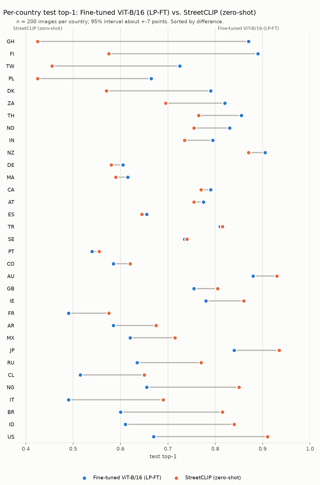
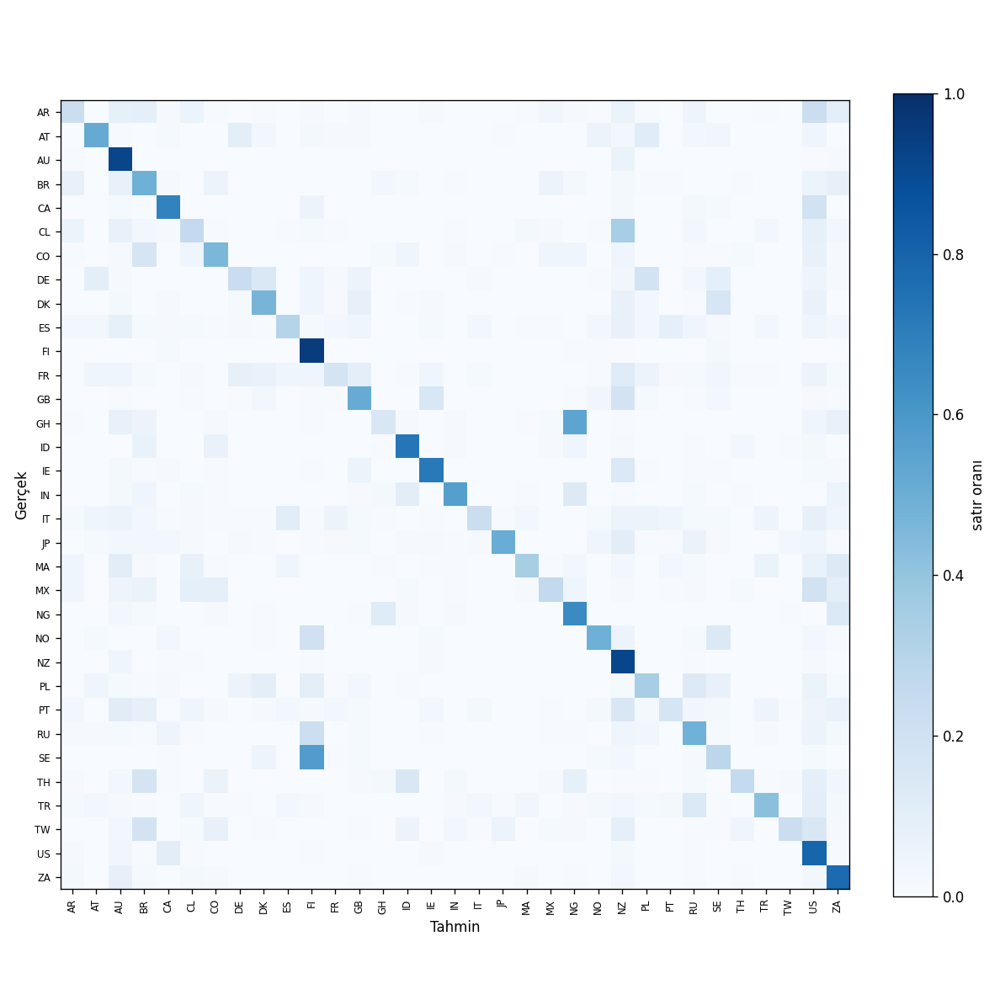
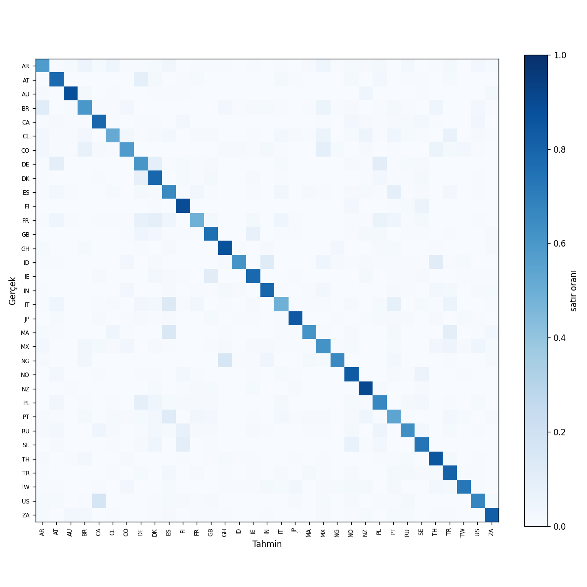
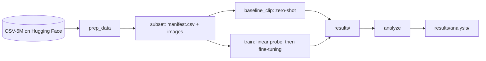

# geoguessr-ai


Predicting the country of street-level photos with CLIP and fine-tuning. The task is 33-way
country classification on a subset of [OpenStreetView-5M](https://huggingface.co/datasets/osv5m/osv5m),
comparing zero-shot CLIP, a linear probe and full fine-tuning (LP-FT).

Main result: CLIP ViT-B/16 with LP-FT reaches 0.708 top-1 on the test split with a single center crop,
24.0 points above the zero-shot accuracy of the same backbone, and on par with StreetCLIP zero-shot
(0.708; ViT-L/14, 336 px). Test-time augmentation (TTA, average over 3 crops) was adopted because it
improved the val split (0.787 to 0.808); with it the model reaches 0.732 top-1 on the test split, 2.4 points
above StreetCLIP zero-shot. That comparison is not fully fair, because StreetCLIP was evaluated without
TTA, and StreetCLIP stays ahead on top-5 (0.958 vs. 0.935).

## Why

GeoGuessr is one of my hobbies. Watching pro players name a country in under half a second, often from little more than the colour of a road line or the shape of a bollard, made me wonder what a model would pick up on. I play to improve myself too, but after a data mining course at İzmir Institute of Technology I decided to move towards machine learning. Last year I started a pathing tool for Elden Ring Nightreign that I never finished; I started this project partly because working with images and fine-tuning seemed like the skills that project was missing. I learned a lot here: building a dataset, setting up fair baselines, and reading a confusion matrix instead of trusting a single accuracy number.

## Results

Test split: 6600 images (200 per country, 33 countries); val split: 3300 images. Random guessing
is about 0.03 top-1. All numbers are read from `results/*/{test,val}_metrics.json`.

| Model | Test top-1 | Test top-5 | Val top-1 |
|---|---|---|---|
| CLIP ViT-B/16, zero-shot | 0.468 | 0.830 | 0.485 |
| CLIP ViT-L/14, zero-shot | 0.544 | 0.903 | 0.598 |
| StreetCLIP, zero-shot (ViT-L/14, 336 px) | 0.708 | 0.958 | 0.723 |
| CLIP ViT-B/16, linear probe | 0.600 | 0.900 | 0.708 |
| CLIP ViT-B/16, LP-FT (fine-tuned) | 0.708 | 0.925 | 0.787 |
| CLIP ViT-B/16, LP-FT + TTA (3 crops) | 0.732 | 0.935 | 0.808 |

Gain from zero-shot to LP-FT on the same backbone: 24.0 points (test top-1). LP-FT versus
StreetCLIP zero-shot: 0.1 points, which is well inside the noise of a single run, so the two are
treated as on par.

TTA (average over the left, center and right crops) was chosen based on the val split: for the same
checkpoint, evaluated with `--eval-only --tta` and no retraining, val top-1 went from 0.787 to 0.808.
On test, top-1 is 0.732 with TTA versus 0.708 without. The TTA model is 2.4 points ahead of StreetCLIP
zero-shot in test top-1 but behind it in top-5 (0.935 vs. 0.958). StreetCLIP was not evaluated with TTA,
so this comparison is not fully fair.

## Findings

Details are in `results/analysis/report.md`; per-country accuracy is in `results/*/test_per_country.csv`.
With 200 test images per country, the 95% interval of a per-country accuracy is roughly +-7 points,
so only differences larger than 10 points are discussed below.

- **Where the gain comes from.** On the same ViT-B/16 backbone, the linear probe adds 13.2 points
  over zero-shot and full fine-tuning adds another 10.8 points on top of the probe (test top-1).
- **Test-time augmentation.** Adopted because of the val split, not the test split. For the same checkpoint,
  test top-1 is 0.732 with TTA versus 0.708 without. It changes the confusion picture only slightly:
  SE to FI is 20 (19 without TTA), CA to US 7 (7), NG to GH 32 (32),
  US to CA 32 (34); the attractor countries are ES, TR (DK, ES without TTA).
  The Nordic, Canada/US, unsolved-confusion and attractor counts below are for LP-FT without TTA.
- **Nordic confusion.** Swedish images predicted as Finland (SE to FI, out of 200 per country):
  115 for B/16 zero-shot, 38 after the linear probe, 19 after LP-FT
  (119 for L/14 zero-shot, 23 for StreetCLIP). For StreetCLIP the dominant direction is
  the reverse: FI to SE is 64, versus 11 for LP-FT.
- **Canada vs. United States.** CA to US: 38 for B/16 zero-shot, 14 after the probe,
  7 after LP-FT (150 for L/14 zero-shot, 37 for StreetCLIP).
- **Per country, LP-FT with TTA vs. StreetCLIP (test top-1, differences > 10 points).**
  - Fine-tuned model better (7 countries): GH (87.0% vs 42.5%, 44.5 points), FI (91.5% vs 57.5%, 34.0 points), TW (73.5% vs 45.5%, 28.0 points), PL (70.0% vs 42.5%, 27.5 points), DK (82.0% vs 57.0%, 25.0 points), ZA (84.5% vs 69.5%, 15.0 points), TH (90.5% vs 76.5%, 14.0 points).
  - Fine-tuned model worse (7 countries): US (69.0% vs 91.0%, 22.0 points), ID (62.5% vs 84.0%, 21.5 points), IT (48.5% vs 69.0%, 20.5 points), NG (66.0% vs 85.0%, 19.0 points), BR (66.0% vs 81.5%, 15.5 points), CL (54.5% vs 65.0%, 10.5 points), JP (83.5% vs 93.5%, 10.0 points).
  - All other countries differ by 10 points or less, which is within the noise level here.
- **Confusions that were not solved, only changed direction.** GH to NG fell from 108 to 6
  while NG to GH is 32 after LP-FT (it was 24 for B/16 zero-shot). US to CA is
  34 after LP-FT (CA to US is only 7); it was 21 for B/16 zero-shot.
- **Attractor countries largely disappear.** Countries that are over-predicted (predicted/true count
  at least 1.3) while precision is below recall: 7 for B/16 zero-shot, 5 for L/14 zero-shot,
  4 for StreetCLIP, 5 after the linear probe, 2 after LP-FT
  (DK, ES). See `results/analysis/precision_recall.csv`.

### Figures

Per-country test top-1 of the fine-tuned ViT-B/16 (LP-FT, with TTA) and StreetCLIP zero-shot, sorted by the
difference between them. Differences smaller than about 7 points are within the 95% interval.



Test confusion matrices of the same backbone before and after fine-tuning (rows are the true
country, columns the predicted one, each row normalized):

<p>
  
  
</p>

Left: CLIP ViT-B/16 zero-shot. Right: CLIP ViT-B/16 LP-FT.

## Limitations

- Single run with a single seed; the variance of training itself is unknown.
- The 33 countries do not represent the world, and the numbers are not comparable to published
  OSV-5M benchmark results (different country set and metrics).
- StreetCLIP is a larger model (ViT-L/14) at a higher resolution (336 px) than the fine-tuned ViT-B/16,
  and it is evaluated zero-shot (and without TTA), while the fine-tuned model was trained on this country set.
- TTA was selected on the val split, which is optimistic (see below); the test gain is a single measurement.
- Val is split from the same pool as train (by sequence), so it is optimistic: the val-test gap is
  7.8 points for LP-FT, versus 1.5 for StreetCLIP and 1.6 for B/16 zero-shot. Compare models on test.
- Over-fitting: in the last of 10 epochs, train top-1 is 0.968 versus 0.787 on val. The
  suggestion that more data would help is an untested inference from this gap.
- The torch-dependent code was only run on Kaggle; it is not covered by the local tests.

## Setup
Locally (no torch/transformers; exploration, data prep and code only):
```
uv sync
```
Kaggle/Colab (internet on). torch and transformers usually come preinstalled, and
`pip install -e .` installs only the core dependencies. If they are missing: `pip install -e ".[ml]"`.
```
pip install -e .
```
To get the ML packages locally as well: `uv sync --extra ml` (large download).

## Usage
### Pipeline



Locally (needs `data/sample`):
```
uv run python -m geoguessr_ai.download_sample
uv run python -m geoguessr_ai.explore
```

On Kaggle:
```
# 1. country distribution, then the subset (manifest + images, resized to short side 256)
python -m geoguessr_ai.prep_data --stats-only
python -m geoguessr_ai.prep_data --out /kaggle/working/subset --resize 256

# 2. zero-shot baselines (results go to results/)
python -m geoguessr_ai.baseline_clip --root /kaggle/working/subset
python -m geoguessr_ai.baseline_clip --root /kaggle/working/subset \
    --model geolocal/StreetCLIP --out results/streetclip_zeroshot
# same backbone as the fine-tuned model (fair comparison)
python -m geoguessr_ai.baseline_clip --root /kaggle/working/subset \
    --model openai/clip-vit-base-patch16 --out results/clip_vitb16_zeroshot

# 3. fine-tuning: quick check with a tiny random model (no download), then the real run
python -m geoguessr_ai.train --root /kaggle/working/subset --smoke
python -m geoguessr_ai.train --root /kaggle/working/subset [--tta]

# evaluate a saved checkpoint only (no probe, no training); results go to results/<run-name>/
python -m geoguessr_ai.train --root /kaggle/working/subset --eval-only --checkpoint <path to best.pt> --tta --run-name clip_vitb16_lpft_tta

# 4. confusion analysis of every run under results/ (writes results/analysis/)
python -m geoguessr_ai.analyze
```

## Tests

```
uv run pytest
uv run ruff check
```

The tests use small synthetic images and manifests and do not need torch/transformers or any
downloaded data, so they run locally. The torch-dependent code (model loading, linear probe,
fine-tuning loop) is not covered by them; it was only run on Kaggle.

## Fine-tuning (`train.py`)
CLIP ViT-B/16 with a classification head initialised from country-name text embeddings
(the template is stored in `run_config.json`). Two stages: a linear probe on frozen features,
then full fine-tuning (AdamW, fp16 AMP, cosine schedule, label smoothing).
No horizontal flip (driving side is a cue); training uses a random near-square crop plus light
brightness/contrast/saturation jitter, small blur and small random erasing (no hue shift).
Evaluation: short side 224 + center crop; `--tta` averages left/center/right crops.

- Best checkpoint (by val top-1): `models/<run>/best.pt`.
- Results use the same file format as `baseline_clip`, so runs are directly comparable:
  `results/<run>/{val,test}_{metrics.json,per_country.csv,confusion.csv,confusion.png,predictions.csv}`,
  linear-probe results in `results/<run>/probe/`, plus `history.csv` and `run_config.json`.
- The test split is evaluated only after training, with the best checkpoint.
- Val is split from the same pool as train (by sequence), so it can be more optimistic than the
  official test split; compare runs on test.

`data/` and `models/` are not tracked; `results/` is.

## Future work

- Split val by creator (not only by sequence) to reduce the val-test gap.
- Evaluate StreetCLIP with TTA, for an equal comparison.
- Linear probe on StreetCLIP.
- More images per country.
- A demo on Hugging Face Spaces.

## License

- Code: MIT (a `LICENSE` file will be added).
- Data: [OpenStreetView-5M](https://huggingface.co/datasets/osv5m/osv5m), **CC BY-SA 4.0**.
  Astruc et al., "OpenStreetView-5M: The Many Roads to Global Visual Geolocation", CVPR 2024.
- Models: [openai/clip-vit-large-patch14](https://huggingface.co/openai/clip-vit-large-patch14),
  [openai/clip-vit-base-patch16](https://huggingface.co/openai/clip-vit-base-patch16),
  [geolocal/StreetCLIP](https://huggingface.co/geolocal/StreetCLIP) (**CC BY-NC 4.0**, no commercial use).

## How I built this

I built this project with Claude Code as a pair programmer: it handled much of the implementation and suggested standard techniques from the fine-tuning literature (LP-FT, a head initialised from text embeddings, Wilson intervals). My part was the project itself:

- **Scope and setup:** I chose 33 countries, built the data pipeline on Kaggle's free GPUs, and ran every experiment there.
- **Experiment design:** I set the order (zero-shot baselines, then a linear probe, then full fine-tuning on the same backbone) so that each step's gain could be measured on its own.
- **Ground rules:**
  - no horizontal flip, because driving side is a real cue;
  - the test split is used once, after training;
  - every number in this README comes from `results/`.
- **Review:** I read the code before each commit and kept the AI to fixed rules in a `CLAUDE.md` file: no commits on its own, seeds everywhere, ask before changing behaviour.
- **Interpretation:** I report "on par" with StreetCLIP rather than "beats", and list the limitations above.

Things that went wrong and what they taught me:

- A Kaggle "Quick Save" created an empty notebook version, and my training notebook silently read from it. Now I pin dataset versions.
- A newer `transformers` release changed what CLIP's feature functions return and broke the baseline. That is why library versions are now logged in `run_config.json`.
- My validation split came from the same pool as training, so validation looked about 8 points better than test. I report test numbers only, and a split by photographer is the first item in future work.