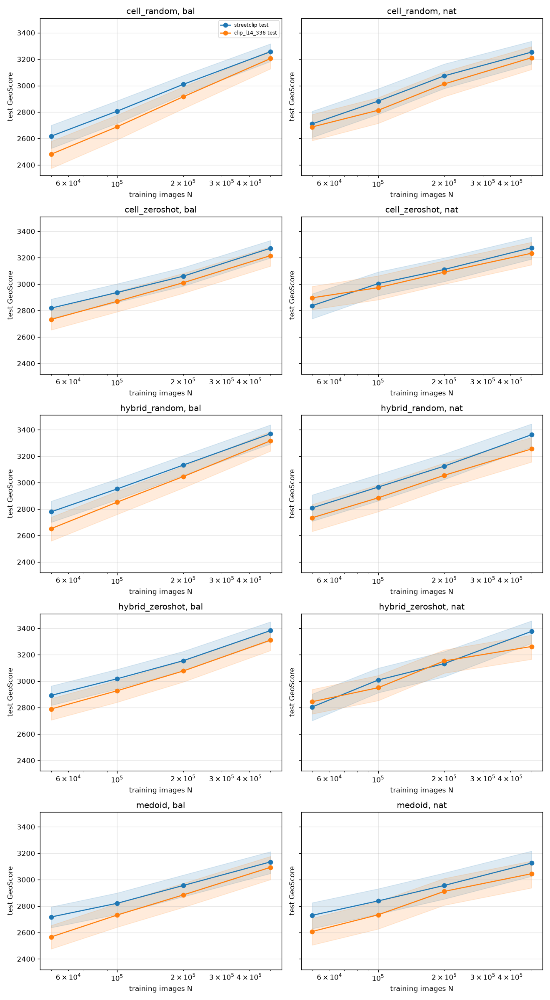
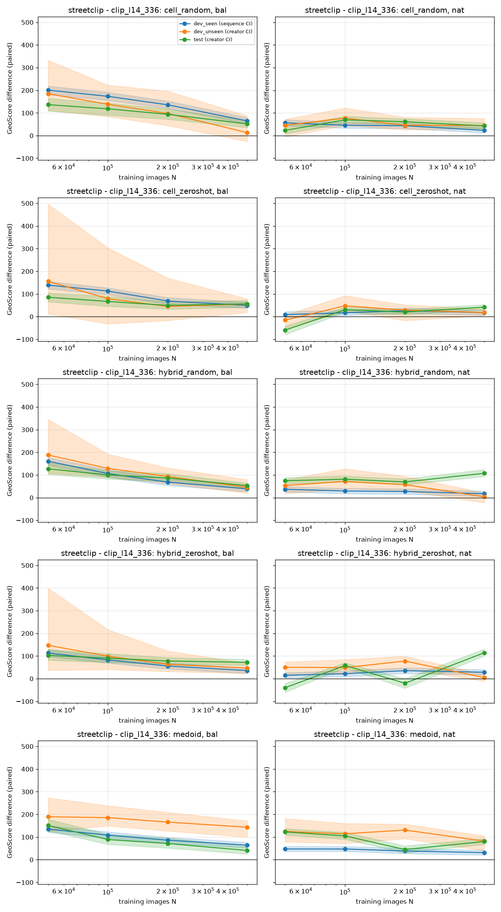

# Phase 3 test results (coordinates on the official OSV-5M test split)

This is the report the pre-registration asks for: [docs/V2_PIPELINE.md, "Phase 3
pre-registration"](../../docs/V2_PIPELINE.md#phase-3-pre-registration-coordinates-on-the-official-test-split),
file `configs/phase3_final.json` (sha256 `6aef5a15fed9662f8e586be417f48d05e7871561edf096afbb4db26c8228d66c`),
committed in [`86d9f8b`](https://github.com/Daggerabuse/geoguessr-ai/commit/86d9f8b328b0bf93f626d0dea0b17bb04c46f540)
on 2026-11-15 21:47 UTC. Dev evidence: [PHASE3_DEV_SUMMARY.md](PHASE3_DEV_SUMMARY.md).

Every table here is copied from the run or derived from it by
`scripts/analysis/phase3_test_report.py`. That script also runs all the checks in the next
section and stops if any of them fails.

- Test set: 210,122 images, 5,323 creators. The largest creator holds 3.3% of the images.
- GeoScore: per image 5000 · exp(−km / 1492.7), averaged (0–5000).
- Gap: StreetCLIP minus CLIP L/14-336 on the same images.
- Brackets: 95% intervals.

## Run identity and checks

The run is identified by the pre-registration sha `6aef5a15…`, the code commit `86d9f8b`, and the
probes' `repro.json` sha `20121787…`. Three Kaggle stages, all at that commit:

| Stage | Started (UTC) | Output |
|---|---|---|
| GPU probes (32 retrained cell probes + reproduction check) | 2026-11-15 22:52 | `runs/phase3_test_probes` |
| CPU test, StreetCLIP (test read from) | 2026-11-16 11:53 | `runs/phase3_test_streetclip` |
| CPU test, L/14-336 (test read from) | 2026-11-16 11:59 | `runs/phase3_test_l14` |
| `primary` on the merged outputs | — | `runs/phase3_test_primary` |

Verified by `phase3_test_report.py`:
- The file at `86d9f8b` and the local file both have sha `6aef5a15…`. The probes' provenance names
  the same file and commit.
- Every `dev_check.json`, `test_read_started.json` and all 80 `test_row.json` carry the identical
  run identity. Each of the 80 merged cells (`test_row.json` and its per-image
  `test_geo_hits.csv`) is byte-identical to the copy in the session that scored it.
  `results.csv` has 80 rows, one run and 210,122 images per cell. **`primary.csv` therefore
  comes from a single run.**
- Dev check: each CPU session checked all 80 cells of both backbones before reading test. 80/80
  were inside the tolerance in both sessions. GPU: 32/32 probes inside the tolerance (details
  below).
- Each CPU session scored its 8 subsets. The `primary` log prints the table below.
- **Exit status.** The notebook runs each stage as `!python … | tee`, so Kaggle does not record
  the module's exit code. What the logs do show: no `Traceback`, `FAILED` or `RESUME NEEDED`;
  every stage printed its normal final message; Kaggle ran each notebook to the end. A
  `SystemExit` in `test` or `primary` would have left a message and no outputs.
- Independent re-run: `phase3_final primary` was run again locally on a copy of the merged
  outputs, with the creator ids from `data/raw/test.csv`. It reproduces `primary.csv`,
  `results.csv` and both exploratory tables to within 5e-14.
- Every H1–H5 and E1 estimate equals the same weighted sum of the per-cell test means in
  `results.csv`.

## Pre-registered hypotheses (primary)

One-sided, 10,000 paired creator-cluster bootstrap resamples, seed 42. Holm over the five rows,
α = 0.05. p = 0.0001 is the floor, 1/10,001.

| | Claim (> 0) | Estimate | Creator 95% CI | p | Holm p | Verdict |
|---|---|---|---|---|---|---|
| H1 | gap, `hybrid_zeroshot`, bal 50K | **+102.9** | [79.7, 129.6] | 0.0001 | 0.0005 | **supported** |
| H2 | gap, `hybrid_zeroshot`, nat 50K | **−39.8** | [−60.4, −20.2] | 1.0 | 1.0 | **not supported**; the estimate is in the opposite direction (CI excludes 0) |
| H3 | gap(50K) − gap(500K), `hybrid_zeroshot`, bal | **+30.7** | [9.2, 54.7] | 0.0024 | 0.0048 | **supported** |
| H4 | gap(cell random) − gap(cell zero-shot), nat 50K | **+82.4** | [61.2, 104.9] | 0.0001 | 0.0005 | **supported** |
| H5 | gap(cell random) − gap(cell zero-shot), bal 50K | **+50.8** | [30.3, 72.0] | 0.0001 | 0.0005 | **supported** |

The sequence-clustered sensitivity columns decide nothing:

| | Seq. 95% CI | Seq. p | Seq. Holm p |
|---|---|---|---|
| H1 | [95.7, 110.0] | 0.0001 | 0.0005 |
| H2 | [−46.4, −33.3] | 1.0 | 1.0 |
| H3 | [22.4, 39.0] | 0.0001 | 0.0005 |
| H4 | [74.8, 90.2] | 0.0001 | 0.0005 |
| H5 | [43.1, 58.6] | 0.0001 | 0.0005 |

As in Phase 1, the sequence intervals are about 3× narrower than the creator intervals.

Table: [`test_primary.csv`](test_primary.csv).

### H2: an unpredicted observation

H2 is **not supported; the estimate is in the opposite direction (CI excludes 0)**. At nat 50K,
L/14-336 with the zero-shot hybrid scores higher on test than StreetCLIP: 2844 vs 2804 GeoScore.
On dev the sign was the other way: dev_seen +14.9 [2.7, 27.3], dev_unseen +50.3 [12.6, 74.3].
The pre-registration had already called H2 the least certain of the five.

This is an **unpredicted observation**, not a finding. The test was one-sided, so "StreetCLIP is
worse at nat 50K" was never a hypothesis and is not confirmed here. It is one cell of one
predictor and one N. Exploratory context, not an explanation:
- The same predictor's nat gap is +58.0 at 100K, −20.0 at 200K (CI [−41.8, 0.2]) and +114.3 at
  500K. The cell probe with zero-shot init also has a negative gap at nat 50K (−59.4); the
  random-init probe and the medoid do not.
- Each backbone has its own k, m, lr and epoch.

We offer no causal story for the sign change.

## Exploratory (uncorrected, no verdict)

Everything in this section is **exploratory**. The intervals are creator-clustered (1,000
resamples, seed 42) and not adjusted for multiplicity. That is also why the H1 row of the gap
table has a slightly different interval than the primary table.

**E1: hybrid minus kNN medoid, nat 500K, averaged over both backbones** (`test_exploratory_contrasts.csv`):
**+234.3 [206.1, 263.4]**. Not like for like: the kNN parts are under the 1 km mask and the
probe inside the hybrid is trained unmasked, so the hybrid is favoured wherever the mask removes
something. On test the mask touches 0.002–0.027% of queries per cell (below). The dev values are
+96.2 (dev_seen) and +60.4 (dev_unseen).

**Gap by predictor × ordering × N** (`test_exploratory_gaps.csv`, plot below). At bal, all 20
gaps are positive and every interval excludes 0. At nat, 17 of 20 are positive with the interval
above 0. Three are negative:

| | 50K | 100K | 200K | 500K |
|---|---|---|---|---|
| `hybrid_zeroshot` nat | −39.8 [−59.5, −20.1] | +58.0 [47.1, 70.1] | −20.0 [−41.8, 0.2] | +114.3 [99.8, 131.1] |
| `hybrid_zeroshot` bal | +102.9 [81.3, 129.4] | +90.7 [71.5, 111.0] | +77.9 [64.1, 93.7] | +72.2 [59.1, 85.8] |
| `cell_zeroshot` nat | −59.4 [−79.2, −42.3] | +30.6 [18.6, 43.3] | +20.3 [8.1, 32.6] | +41.7 [31.0, 53.2] |

**Nat shrink** (`test_exploratory_nat_shrink.csv`). No direction was pre-registered for it.
gap(50K) − gap(500K), `hybrid_zeroshot`, nat: **−154.1 [−181.1, −128.2]**, i.e. −39.8 at 50K vs
+114.3 at 500K. The gap is larger at 500K than at 50K, but the curve between the two is not
monotone (table above). On dev the nat shrink had no consistent sign: dev_seen −13.5
[−29.7, 2.3] (gaps +14.9 → +28.5), dev_unseen +45.3 [17.0, 63.4] (gaps +50.3 → +5.0), from
`phase3_backbone_shrink.csv`.

**Per-cell results** are in [`test_results.csv`](test_results.csv): all 80 cells with test
GeoScore and its creator interval, median and mean km, and accuracy within 1/25/200/750/2500 km,
next to the pre-registered dev_seen and dev_unseen GeoScores, the chosen k/m/lr/epoch and the
`grid_edge` flags. The primary predictor:

| `hybrid_zeroshot` | 50K | 100K | 200K | 500K | median km at 500K |
|---|---|---|---|---|---|
| StreetCLIP, nat | 2804 | 3008 | 3133 | 3376 [3286, 3456] | 316 |
| L/14-336, nat | 2844 | 2950 | 3153 | 3262 [3166, 3348] | 376 |
| StreetCLIP, bal | 2892 | 3018 | 3154 | 3383 [3307, 3449] | 324 |
| L/14-336, bal | 2789 | 2927 | 3076 | 3310 [3232, 3382] | 358 |

- **Masked share:** in every cell, 0.002–0.027% of test queries had a training image within 1 km
  that the mask removed (`test_masked_any_share`).
- **Hybrid fallback share:** at most 0.015% (`test_fallback_share`).

*Test GeoScore vs training-set size N, StreetCLIP vs L/14-336, per predictor × ordering. Bands:
per-cell creator-clustered 95% intervals. These are not paired; the paired gaps are in the next
plot.*

*StreetCLIP − L/14-336, paired per image, on dev_seen (sequence intervals), dev_unseen (creator
intervals; 20K images, hence wide) and test (creator intervals). Exploratory.*

## Reproduction check

Tolerances (pre-registered): top-1 cell the same for ≥ 99% of dev_seen queries, top-5 set the
same for ≥ 95%, |GeoScore difference| ≤ 2 for probes and hybrids, ≤ 0.5 for the medoid. All 192
rows are in [`test_repro_summary.csv`](test_repro_summary.csv); raw files `test_repro.json` and
`test_dev_check_*.json`.

| Check | Cells | Min top-1 same | Min top-5 same | Max \|ΔGeoScore\| |
|---|---|---|---|---|
| GPU retrain (logits), cell probes | 32/32 ok | 1.0 | 1.0 | 0.0 |
| CPU, saved heads, cell probes (each session) | 32/32 ok | 0.99995 | 0.99985 | 0.038 |
| CPU, hybrids (each session) | 32/32 ok | — | — | 0.075 |
| CPU, medoid (each session) | 16/16 ok | — | — | 0.006 |

The GPU retrain reproduced the stored dev_seen GeoScore exactly in all 32 probes. The CPU
differences are the tie and float effects the pre-registration anticipated. Both CPU sessions
produced identical check numbers.

## Dev vs test

[`test_dev_vs_test.csv`](test_dev_vs_test.csv) lists the same statistic on each split. The dev
intervals come from the committed dev tables: sequences on dev_seen, creators on dev_unseen, 1,000
resamples. There is no stored dev interval for H4, H5 and E1.

| | dev_seen | dev_unseen | test |
|---|---|---|---|
| H1 | +113.2 [97.8, 129.1] | +147.3 [36.4, 399.5] | +102.9 [79.7, 129.6] |
| H2 | +14.9 [2.7, 27.3] | +50.3 [12.6, 74.3] | **−39.8** [−60.4, −20.2] |
| H3 | +77.3 [57.7, 96.2] | +100.1 [−7.3, 346.9] | +30.7 [9.2, 54.7] |
| H4 | +47.4 | +61.0 | +82.4 [61.2, 104.9] |
| H5 | +61.6 | +28.6 | +50.8 [30.3, 72.0] |
| E1 (exploratory) | +96.2 | +60.4 | +234.3 [206.1, 263.4] |

Descriptive comparisons:
- **Test is much harder than dev.** Across the 80 cells, test GeoScore is 621–1358 below dev_seen
  (mean −989) and 266–984 below dev_unseen (mean −581). Phase 1 saw the same direction for
  country top-1.
- **Predictor ranking.**
  - On dev_seen, a hybrid was best in every one of the 16 backbone × ordering × N cells, the
    zero-shot hybrid in 12.
  - On test, a hybrid is best in 13 (the zero-shot hybrid in 12). The zero-shot cell probe is
    best in the other 3: nat 50K for both backbones, and nat 100K for L/14-336.
  - The medoid ranks 4th or 5th in every test cell.
- **Gap directions.** H1, H3, H4 and H5 have the same sign on all three splits. H3 is smaller on
  test than on either dev split. H4 is larger.

## Limitations

These are the pre-registered limitations, unchanged in substance:
- **lr grid edge:** 13 of the 32 declared cell probes chose the lowest lr of their grid
  (`lr_low`). The grid is final; neighbour margins are in `phase3_cell_flags.csv`.
- **m grid edge:** 23 of the 32 declared hybrids chose m = 5, the top of {1, 3, 5} (`m_high`).
  m > 5 was not run.
- **Epoch cap:** 2 probes chose epoch 60, the cap; 14 never stopped early.
- **Rule timing:** the lr-edge threshold was written after some live Kaggle logs had been seen,
  and the m grid was frozen after its counts were seen. The hybrid's medoid predictor and the
  5000-cell count were chosen on dev_seen.
- **dev_seen optimism:** every choice, including the primary predictor, was made on dev_seen.
  dev_seen shares creators with train and has no distance buffer. Test did in fact rank the
  predictors slightly differently (above).
- **Masked kNN vs unmasked probe:** this is why E1 is exploratory. The mask also need not cost the
  two backbones the same (H1–H3); on test it touches at most 0.027% of queries per cell. An
  unmasked medoid was not computed.
- **Percentile-bootstrap p:** not a test under a constructed null, and unstable with very large
  creators. The largest creator holds 3.3% of test.
- **Separate tuning:** each backbone has its own k, m, lr and epoch. A gap includes any difference
  in how well the shared grids suit each backbone.
- **Not blind:** Phase 1 had already scored country top-1 on the same test images (StreetCLIP
  ahead at 50K, test harder than dev). H1 and H2 were not blind to that.
- **Per-cell scores seen early:** each test session printed per-cell scores before the paired
  analysis existed. Nothing was changed after `test_read_started.json` was written; the run
  identity checks above cover this.
- **Retrain:** the retrain is not guaranteed bit-identical to the dev probes. Here the GPU
  GeoScores matched exactly, and the hypotheses are about the retrained heads.
- **Ties:** exactly tied cells can be ordered differently on GPU and CPU. The dev_seen check
  bounds how often (≥ 99.985% identical top-5 sets); ties are not counted separately.
- **Self-discipline, not proof:** git timestamps and provenance files are written by us. The
  outside record is GitHub's push time of `86d9f8b` (on `origin/phase3`). The test embeddings
  are older than the pre-registration.

## What this does NOT show

- **H2:** not that StreetCLIP is worse at nat 50K (one-sided test, unpredicted direction). Also
  not that there is no gap.
- **H4/H5:** nothing about why the zero-shot init narrows the gap (text-initialised head vs
  ceiling effect), nothing about the hybrid, nothing above 50K.
- **H1:** no more than a confirmation, in km, of what Phase 1 showed for countries at bal 50K.
- **Causation:** not that StreetCLIP's training causes a gap; the backbones also differ in how
  well the grids fit them.
- **Best predictor:** not that the hybrid is the best coordinate predictor, or better than kNN.
  E1 is exploratory, one N, one ordering, not like for like.
- **Scope:** nothing confirmatory about B/16 (not scored on test), N = 100K/200K, the random
  hybrid, median km, accuracy at a distance, countries or creators.
- **OSV-5M paper:** the numbers are not comparable with the paper beyond the shared metric (50K–500K
  subsets, frozen backbones).
- **Fine-tuning:** nothing about fine-tuned models.
